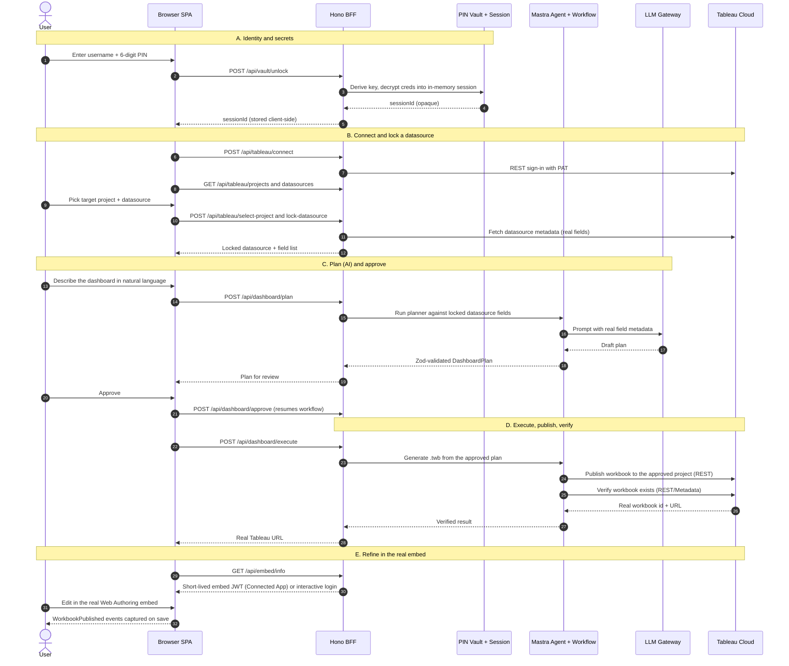

# TableauPilot AI — Project Overview

> A plain-language onboarding guide that ties together the README and the `docs/*`
> set. For binding invariants and deep detail, always defer to the authoritative docs
> linked at the bottom.

## What this project is

TableauPilot AI is an **agentic AI copilot for Tableau Cloud**. You describe a dashboard
in plain English; the app plans it against your **real** Tableau datasource metadata,
asks for your approval, generates a real Tableau workbook (`.twb`), **publishes it to
Tableau Cloud over REST**, opens the **real** Web Authoring embed for hands-on
refinement, and **verifies** the published result — returning the actual Tableau URL.

It also includes a **"Build datasource"** feature: connect to a source (**Salesforce** or
**Excel** today), model it (relationships or joins), and publish an **extract-backed**
Tableau datasource.

Two design commitments run through everything:

- **No fabrication.** Every success (workbook exists, URL, fields) is verified via the
  Tableau REST/Metadata API — never guessed or faked.
- **Secrets never leave the server.** Per-user credentials live in a
  6-digit-PIN-encrypted, server-side vault and never reach the browser or the LLM.

## Who it's for

Tableau Cloud users who want to go from a natural-language request to a real, published,
refine-able dashboard — without the AI pretending to do things Tableau's APIs don't
actually support.

## The big picture (architecture)

The app is a **BFF (Backend-for-Frontend)**: a React SPA talks only to a Node/Hono server
via an opaque `x-session-id`; the server holds all secrets and talks to Tableau and the
LLM.

```
Browser SPA (React/Vite)                 Node server (Hono BFF)                External
  - session id only          -- /api -->  - Mastra agents + tools    -- REST -->  Tableau Cloud
  - real Web Authoring embed              - PIN-encrypted vault       -- API -->  LLM gateway
                                          - .twb / .tds generation    -- query -> Salesforce
                                          - Python Hyper sidecar (extracts)
```

- **Frontend:** React SPA under `app/` (Vite dev server on `:5173`), proxying `/api` to
  the backend.
- **Backend:** Hono server under `src/server/` (`:4000`), orchestrating Mastra agents,
  Tableau REST calls, datasource building, and publishing.
- **AI runtime:** [Mastra](https://mastra.ai) agents/tools/workflows (`src/agents`,
  `src/tools`, `src/workflows`). The same brain is inspectable via Mastra Studio
  (`npm run dev:studio`).
- **Extract sidecar:** a narrow Python script (Tableau Hyper API) used only to
  materialize `.hyper` extracts, invoked as a subprocess — the sole non-TypeScript piece.

## Two main user flows

### 1. Create a dashboard (the core flow)

1. **Vault** — register username + 6-digit PIN, save Tableau credentials (cloud URL,
   site, PAT, optional Connected App). Later, unlock with the PIN.
2. **Connect & lock** — connect to Tableau Cloud, choose the target project, and **lock**
   a published datasource as the session's single source of truth.
3. **Plan -> approve -> execute** — describe the dashboard; the agent inspects the locked
   datasource's real fields and returns a Zod-validated `DashboardPlan`. You approve; the
   server generates the `.twb`, publishes it to the approved project, and verifies it.
4. **Refine** — the published workbook opens in the real Web Authoring embed; you finish
   anything the APIs can't automate by hand, and saves are captured via real
   `WorkbookPublished` events.

### 2. Build a datasource (connectors)

- **Salesforce** — connect (username/password or OAuth), pick one or more objects, model
  them (Relationship or Join), publish. Rows are queried and materialized into a local
  `.hyper`, published, the saved Salesforce OAuth credential is embedded, and an extract
  refresh is triggered.
- **Excel** — upload an `.xlsx`; each **sheet** becomes an object for the same
  Relationship/Join modeling. Published **extract-only** (the bundled `.hyper` is the
  data — no live connection, no embedded credential, no refresh).

Both reuse the same shared machinery: the `DataModelBuilder` UI, the TDS-generation
helpers, the Hyper sidecar, and the publish pipeline.

## End-to-end flow (start to finish)

This traces a single request from opening the app to a verified, published dashboard you
can refine. Everything the browser does goes through `/api` with only an opaque
`x-session-id`; all secrets and external calls happen server-side.



Step-by-step, tied to the code:

1. **Unlock the vault** (`app/components/CredentialsPanel.tsx` -> `POST /api/vault/unlock`).
   The PIN derives the AES key (`src/vault`), decrypts your Tableau credentials into an
   in-memory session, and returns only an opaque `sessionId`.
2. **Connect to Tableau** (`SetupPanel.tsx` -> `POST /api/tableau/connect`). The server
   signs in to the REST API with your PAT (`src/tableau/auth`), caching the token
   server-side.
3. **Choose + lock a datasource** (`select-project`, `lock-datasource`). The locked
   datasource becomes the session's single source of truth; its real fields are fetched
   via the Metadata API (`src/tableau/datasources`, `discovery`) so the AI only ever plans
   against fields that actually exist.
4. **Plan** (`PlanPanel.tsx` -> `POST /api/dashboard/plan`). The `dashboardPlannerAgent`
   (`src/agents`) prompts the LLM with the real field metadata and returns a
   **Zod-validated** `DashboardPlan` (`src/schemas`). Invalid AI output is rejected before
   anything executes.
5. **Approve** (`POST /api/dashboard/approve`). This resumes the suspended
   `dashboardCreationWorkflow` (`src/workflows`) — the human approval gate.
6. **Execute** (`POST /api/dashboard/execute`). The authoring tools
   (`src/tableau/authoring`) deterministically generate the `.twb` (never the LLM writing
   XML), then the publishing layer (`src/tableau/publishing`) pushes it to the approved
   project.
7. **Verify** (`src/tableau/verification`). The server confirms via REST/Metadata that the
   workbook exists in the exact project, reads its real URL, and only then reports success.
8. **Refine** (`GET /api/embed/info` -> `PublishedViewPanel.tsx`). The real Web Authoring
   embed opens on the published workbook; a short-lived Connected App JWT authenticates it
   (or interactive login as fallback). Your manual edits are captured via real
   `WorkbookPublished` events.

### Connector build flow (start to finish)

When you instead choose **Build datasource** in `SetupPanel.tsx`:

1. **Connect / upload** — Salesforce: `POST /api/connectors/salesforce/connect` logs in
   and lists objects; Excel: `POST /api/connectors/excel/upload` parses the workbook
   (`src/excel/excelClient.ts`) into sheets. State is transient on the session.
2. **Model** — the shared `DataModelBuilder.tsx` lets you add tables/sheets and define
   relationships or physical joins; join fields come from `describe` calls.
3. **Publish** — `POST /api/connectors/<name>/publish` calls the orchestrator in
   `src/tableau/index.ts`: it generates the `.tds` (`authoring/tdsGenerator.ts` /
   `excelTdsGenerator.ts`), materializes a `.hyper` via the Python sidecar
   (`publishing/hyperPackager.ts`), and publishes the `.tdsx`
   (`publishing/datasource.ts`).
4. **Credential + refresh (Salesforce)** — the saved Salesforce OAuth credential is
   embedded on the connection and an extract refresh is triggered. **Excel** is
   extract-only (bundled `.hyper` is the data; no credential, no refresh).
5. **Lock + continue** — the freshly published datasource is locked, and the normal
   dashboard flow above proceeds unchanged.

## Tech stack

- **Language/runtime:** TypeScript on Node.js >= 20.9.
- **Frontend:** React + Vite SPA.
- **Backend:** Hono HTTP server.
- **AI:** Mastra (agents, tools, workflows, memory); LLM via an Anthropic-compatible
  gateway or OpenRouter.
- **Tableau:** REST + Metadata APIs; server-side `.twb`/`.tds` XML generation.
- **Extracts:** Tableau Hyper API via a Python sidecar (`.venv-hyper`), plus `exceljs` for
  Excel parsing.
- **Validation:** Zod schemas for all AI output and API boundaries.
- **Testing:** Vitest (unit/integration), Playwright (e2e).

## Repository layout (high level)

- `app/` — React SPA (`components/`, `api.ts`, `types.ts`).
  - `components/SetupPanel.tsx` — connect, pick project, lock datasource, and the "Build
    datasource" connector switch (the Salesforce sub-flow lives inline here).
  - `components/DataModelBuilder.tsx` — shared relationship/join modeling UI.
  - `components/ExcelBuild.tsx` — the Excel connector sub-flow.
- `src/server/` — Hono app (`app.ts` routes, `index.ts` bootstrap).
- `src/agents/` — Mastra agents (`tableauPilotAgent`, `dashboardPlannerAgent`,
  `calculationEngineerAgent`, plus knowledge).
- `src/tools/` — agent tools (auth, discovery, datasource, authoring, calculation,
  publishing, verification).
- `src/workflows/` — `dashboardCreationWorkflow` (suspend/resume for approval) and phases.
- `src/tableau/` — Tableau integration:
  - `index.ts` — the `TableauService` orchestrator (connect, lock, publish, connector
    builds).
  - `authoring/` — `.twb`/`.tds` generation (`tdsGenerator.ts` shared helpers,
    `excelTdsGenerator.ts`, worksheet/chart/filter/calc builders, `twbxPackager.ts`).
  - `publishing/` — `datasource.ts` (publish, embed credential, refresh), `hyperPackager.ts`
    (sidecar).
  - `auth/`, `discovery/`, `datasources/`, `permissions/`, `verification/`.
- `src/salesforce/` — Salesforce client + OAuth (`client.ts`, `oauth.ts`, `oauthStore.ts`).
- `src/excel/` — `excelClient.ts` (workbook parsing).
- `src/vault/` — PIN-encrypted credential vault, sessions, crypto.
- `src/schemas/` — Zod schemas (`common.ts` holds connector build/relationship schemas).
- `src/config/`, `src/llm/`, `src/memory/`, `src/observability/`, `src/utils/` — infra.
- `scripts/hyper/` — the Python Hyper extract sidecar.
- `docs/` — the authoritative documentation set (see below).
- `reference/` — sample `.tds`/`.tdsx` files used to reverse-engineer Tableau's XML.

## Security model (in one paragraph)

Identity is a username + 6-digit PIN; the PIN derives an AES-256-GCM key (via scrypt with
a server-only `VAULT_PEPPER` + per-user salt) that encrypts credentials at rest. On
unlock, decrypted secrets live only in an in-memory session keyed by an opaque
`sessionId`; the browser holds only that id. Logs, traces, LLM inputs, and tool outputs
are redacted/sanitized so tokens never leak. Connector credentials (Salesforce/Excel) are
transient and cleared after publish; published datasources rely on Tableau Cloud's saved
credentials, not secrets this app stores. Full detail: `docs/security.md`.

## How to run

```bash
npm install
cp .env.example .env      # set VAULT_PEPPER, LLM provider + key, TABLEAU_API_VERSION
npm run setup:hyper       # optional: Hyper sidecar for the datasource builders
npm run dev               # API (:4000) + web (:5173)
```

Open http://localhost:5173. Production: `npm run build` then `npm start`. Tests:
`npm run typecheck && npm run lint && npm test` (and `npm run test:e2e`).

## Key constraints to know

- **Programmatic shelf/mark/filter editing is not supported by Tableau's embed JS API** —
  the app never fakes it; it hands those steps to you in the real embed
  (`docs/authoring-limitations.md`).
- **Generated `.twb` is best-effort** and may need field re-binding/visual tuning.
- **File connectors are extract-only** (a local file path can't live-connect on Cloud).
- **Server-side `createExtract` is unsupported on the target Cloud site**, so extracts are
  built locally via the Hyper sidecar.

## Where to go next (authoritative docs)

- Product scope: `docs/prd.md` - Architecture: `docs/architecture.md` - Detailed design:
  `docs/design.md`
- Rules/invariants: `docs/rules.md` - Build phases: `docs/phases.md` - Progress log:
  `docs/memory.md`
- API capabilities: `docs/tableau-api-capabilities.md` - Authoring limits:
  `docs/authoring-limitations.md`
- Auth: `docs/authentication.md` - Security: `docs/security.md` - Python usage:
  `docs/python-dependency-decision.md`
